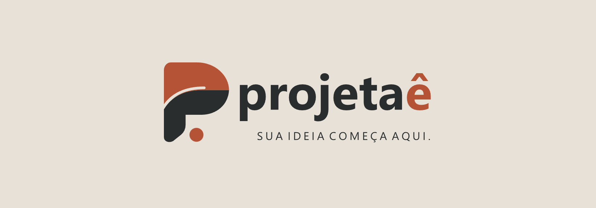

🚧 **Projeto em desenvolvimento.**

## Sobre o Projetaê

O Projetaê ajuda pessoas a transformar uma ideia em uma solicitação clara de projeto digital. O briefing guiado reúne objetivos, contatos e referências para facilitar o entendimento da proposta.

**Landing → Briefing guiado → revisão → envio da solicitação → confirmação.**

O frontend oferece navegação em etapas, validação dos campos, revisão e edição das respostas, layout responsivo e uma experiência visual de envio com tratamento de falhas. As respostas permanecem em memória durante a navegação; recarregar a página descarta os dados.

O produto possui integração real de envio. Este repositório é sua versão de portfólio: apresenta a experiência e uma amostra técnica do backend, omitindo componentes administrativos e configurações privadas. A execução local não inclui um serviço de envio configurado.

## Arquitetura

React e TypeScript organizam a interface, o estado do briefing e o cliente HTTP. Vite e Tailwind CSS compõem a base de desenvolvimento e estilos. O cliente envia as respostas a uma Edge Function, que valida a entrada antes de solicitar a persistência no Supabase e devolve uma confirmação ou um erro tratado.

A [amostra de backend](supabase/functions/submit-request/README.md) inclui validações e testes isolados com dados fictícios. Configurações de implantação e migrations do produto não fazem parte desta versão.

## Executar localmente

Com Node.js e npm instalados, execute na pasta do projeto:

```sh
npm install
npm run dev
```

## Verificações

```sh
npm run lint
npm run build
node --test supabase/tests/submit-request.test.mjs
```

<p align="center">
  
  <br>
  <sub>Desenvolvido por</sub>
  <br>
  <strong>Isaac Gabriel</strong>
  <br><br>
  <a href="https://github.com/isaacgbr"></a>
  <a href="https://www.linkedin.com/in/isaacgbr"></a>
</p>
